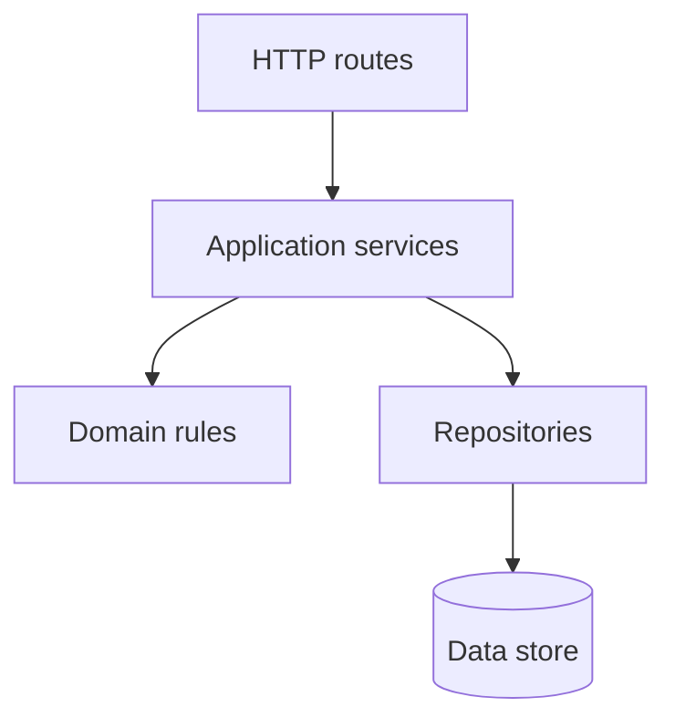
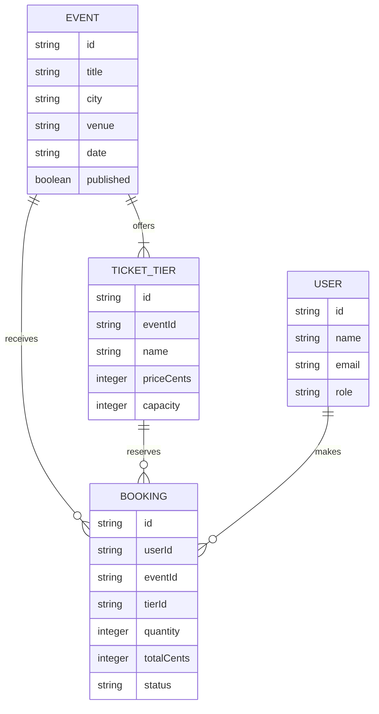
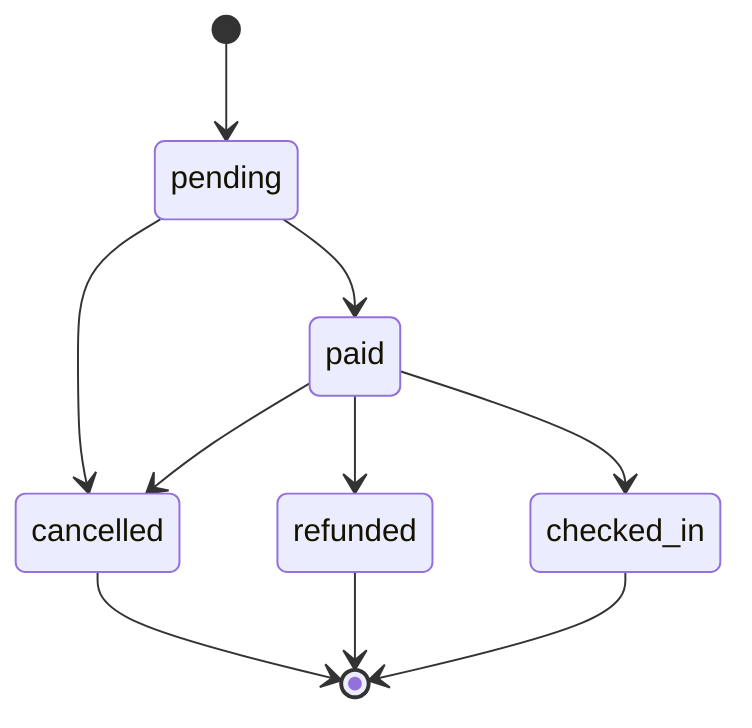

# Architecture

## Layers

- **Routes** may translate HTTP input and output; they may not implement business rules or access storage directly.
- **Services** may coordinate domain rules and repositories; they may not depend on HTTP details or send responses.
- **Rules** may enforce business invariants; they may not perform I/O or depend on services, routes, or repositories.
- **Repositories** may read and write data; they may not implement business policy or call higher layers.
- **Data** is stored state; it does not call application code.

## Data model

## Booking life cycle

